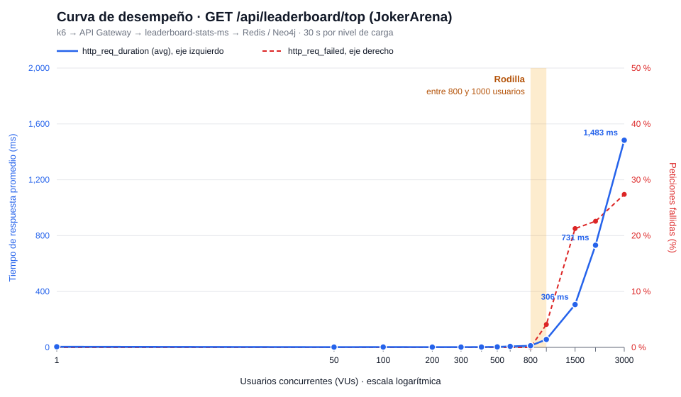

# Laboratorio 6 · Performance (k6)

Pruebas de carga sobre la funcionalidad de **ranking global** de JokerArena.
Código probado: `origin/main` en `a67be5b` (4 de noviembre de 2026).

## Componentes desplegados

| Componente | Contenedor |
|---|---|
| Base de datos | `jokerarena-neo4j` (grafo del ranking) + `jokerarena-redis` (caché del top) |
| Microservicio | `jokerarena-leaderboard-stats-ms` (TypeScript, Fastify) |
| API Gateway | `jokerarena-gateway` (nginx, `:8080`) |
| Web front-end | `jokerarena-web-ssr` (Next.js, `:3000/leaderboard`) |

`jokerarena-rabbitmq` también está arriba porque el microservicio depende de él.
Datos de prueba: 200 jugadores y 600 partidas (`seed_leaderboard.py`).

## Prueba

- Herramienta: k6 v2.4.0. Script: [`performance_test.js`](performance_test.js).
- Petición: `GET http://localhost:8080/api/leaderboard/top?limit=10` (k6 → gateway → microservicio → Redis/Neo4j).
- Cada usuario virtual hace una petición y espera 1 s (`sleep(1)`).
- Por nivel: los usuarios entran repartidos en 1 s (equivale al *Ramp-Up Period: 1* de JMeter) y la carga se mantiene 30 s.
- Un nivel por ejecución (`k6 run -e VUS=<n> -e RAMP_UP=1s perf/lab6/performance_test.js`), con 70 s de pausa entre niveles.

## Resultados

| Usuarios (VUs) | Peticiones | Throughput exitoso (req/s) | `http_req_duration` avg (ms) | avg solo 200 (ms) | p95 solo 200 (ms) | `http_req_failed` | Fallas 503 | Sin respuesta | Segundo de las fallas |
|---:|---:|---:|---:|---:|---:|---:|---:|---:|---:|
| 1 | 30 | 1.0 | 4.3 | 4.3 | 3.0 | 0.00 % | 0 | 0 | — |
| 50 | 1 546 | 48.3 | 2.0 | 2.0 | 3.1 | 0.00 % | 0 | 0 | — |
| 100 | 3 090 | 96.6 | 2.8 | 2.8 | 4.8 | 0.00 % | 0 | 0 | — |
| 200 | 6 184 | 193.3 | 2.0 | 2.0 | 3.2 | 0.00 % | 0 | 0 | — |
| 300 | 9 279 | 290.0 | 2.2 | 2.2 | 3.7 | 0.00 % | 0 | 0 | — |
| 400 | 12 370 | 386.6 | 2.3 | 2.3 | 4.1 | 0.00 % | 0 | 0 | — |
| 500 | 15 454 | 482.8 | 3.6 | 3.6 | 14.1 | 0.00 % | 0 | 0 | — |
| 600 | 18 493 | 577.8 | 7.1 | 7.1 | 26.1 | 0.00 % | 0 | 0 | — |
| 800 | 24 517 | 765.9 | 11.5 | 11.5 | 41.7 | 0.00 % | 0 | 0 | — |
| 1 000 | 29 439 | 875.4 | 57.0 | 49.6 | 210.6 | 4.10 % | 1 208 | 0 | 29.7–31.2 |
| 1 500 | 35 859 | 868.8 | 306.5 | 257.2 | 558.8 | 21.27 % | 7 628 | 0 | 23.5–31.5 |
| 2 000 | 36 452 | 851.0 | 731.4 | 645.6 | 1658.2 | 22.57 % | 8 229 | 0 | 4.9–32.2 |
| 3 000 | 38 750 | 789.0 | 1483.1 | 1218.1 | 3059.9 | 27.38 % | 10 435 | 176 | 0.2–33.3 |

- **Throughput exitoso:** solo las peticiones respondidas con 200.
- **`http_req_duration` avg:** todas las peticiones, que es la métrica que pide la guía. Incluye las fallidas, que responden rápido y bajan el promedio; por eso se muestra también el promedio de las respuestas 200.
- **Fallas 503:** el gateway no pudo conectarse al microservicio. **Sin respuesta:** k6 no logró abrir la conexión con el gateway.

Datos crudos: [`results/results.csv`](results/results.csv) y `results/vus_*.json`.

## Curva de desempeño



## Rodilla

**La rodilla está entre 800 y 1 000 usuarios concurrentes** (≈ 770–880 req/s):
800 es el último nivel con `http_req_failed = 0 %` y 1 000 el primero con errores (4.10 %).

Los dos indicadores coinciden en el mismo punto:

- **Errores:** 0 % hasta 800 usuarios; 4 % a 1 000 y más de 20 % desde 1 500.
- **Tiempo de respuesta:** plano (2–4 ms) hasta 500 usuarios, sube suavemente hasta 11.5 ms a 800 y se dispara después: 57 ms a 1 000, 306 ms a 1 500 y 1.5 s a 3 000.
- **Throughput exitoso:** crece en línea recta con los usuarios hasta 800 y desde 1 000 se estanca entre ~790 y ~875 req/s, aunque se agreguen más usuarios.

## Cuello de botella

El que falla es el **API Gateway**, no el microservicio ni las bases de datos. Todas las fallas hasta 2 000 usuarios
son respuestas `503` del gateway, y su log muestra la causa:
`connect() to <leaderboard-stats-ms>:8086 failed (99: Address not available)`.

nginx abre una conexión TCP nueva hacia el microservicio por cada petición (no hay `keepalive` hacia el upstream).
Cada conexión ocupa un puerto efímero del contenedor, que tras cerrarse queda reservado 60 s (`TIME_WAIT`).
El contenedor tiene 28 232 puertos efímeros (32768–60999), y los datos lo reflejan con exactitud: en todos los
niveles saturados las respuestas exitosas se detienen en el mismo número.

| Usuarios | Respuestas 200 |
|---:|---:|
| 1 000 | 28 231 |
| 1 500 | 28 231 |
| 2 000 | 28 223 |
| 3 000 | 28 139 |

Consecuencia: **el límite depende de la duración de la prueba.** En 30 s solo se agotan los puertos si se superan
~28 000 peticiones, lo que ocurre a partir de ~1 000 usuarios. En una prueba más larga el límite sostenido es
28 232 puertos ÷ 60 s ≈ **470 req/s**. Se comprobó: 600 usuarios, que en 30 s no fallan, durante 90 s empiezan a
fallar en el segundo 51.7 y terminan con 10.15 % de errores (`results/_diag/vus_00600_90s.json`).

Mejora sugerida: definir un bloque `upstream` con `keepalive` en `gateway/nginx.conf` para reutilizar conexiones.

## Verificación de los datos

Los resultados publicados se comprobaron de cuatro formas. `python perf/lab6/verify_results.py` repite las que no dependen del servidor.

1. **Aritmética:** cada nivel hizo entre 99 % y 105 % de las peticiones esperadas, y las fallas clasificadas suman el total.
2. **Cruce con el servidor:** las respuestas 200 y 503 que registró nginx durante cada ejecución coincidieron exactamente con las que contó k6, en los 13 niveles. Esto también descarta carga ajena durante las pruebas. Este cruce solo se puede hacer mientras existe el contenedor que atendió la prueba, así que se repite sobre cada ejecución nueva (ver "Reproducir").
3. **Reproducibilidad:** segunda ejecución de 300, 600, 1 000 y 1 500 usuarios (`results/_repeat`).

| Usuarios | Fallos 1ª | Fallos 2ª | Throughput exitoso 1ª | Throughput exitoso 2ª | avg 1ª (ms) | avg 2ª (ms) |
|---:|---:|---:|---:|---:|---:|---:|
| 300 | 0.00 % | 0.00 % | 290.0 | 289.9 | 2.2 | 2.1 |
| 600 | 0.00 % | 0.00 % | 577.8 | 576.4 | 7.1 | 8.4 |
| 1 000 | 4.10 % | 5.73 % | 875.4 | 881.2 | 57.0 | 35.0 |
| 1 500 | 21.27 % | 22.26 % | 868.8 | 871.1 | 306.5 | 287.7 |

4. **Entregables:** `results.csv`, la tabla de este documento, la rodilla y los puntos de la gráfica salen de los JSON crudos.

Además, el procedimiento completo se repitió desde un clon limpio del repositorio y dio la misma rodilla (entre 800 y 1 000 usuarios), 0 fallas hasta 800 usuarios y el mismo tope de 28 231 respuestas exitosas.

## Limitaciones

- **Nodo de pruebas:** k6 corrió en la misma máquina que los contenedores (Windows + Docker Desktop). La guía pide un nodo independiente; con un solo equipo el generador de carga compite por CPU con el sistema.
- **Sensibilidad al estado del equipo:** los tiempos de respuesta cerca de la rodilla dependen del equipo. Con el portátil funcionando con batería (`results/_bateria`), 800 usuarios dio 115 ms, 900 dio 160 ms y 1 000 dio 282 ms, todos con 0 % de fallas porque, al ir más lento, no se alcanzan las ~28 000 peticiones en 30 s. Los niveles hasta 600 usuarios no cambian. Esas mediciones no se mezclan con la tabla principal.
- **Punto de 100 usuarios:** se volvió a medir más tarde que el resto de la serie; el resultado fue el mismo (3 090 frente a 3 092 peticiones, 0 fallas).
- **Arranque simultáneo:** sin rampa (todos los usuarios en el mismo instante) el reenvío de puertos de Docker Desktop rechaza las conexiones que pasan de ~210, solo en el primer segundo (`results/_diag/vus_00400_sin_rampa.json`). Por eso las pruebas usan la rampa de 1 s de la guía. Las 176 fallas "sin respuesta" a 3 000 usuarios son ese mismo efecto.
- **Caché:** el top se guarda en Redis 30 s, así que casi todas las peticiones se resuelven desde la caché y no desde Neo4j.
- **Duración:** 30 s por nivel. Como se explicó, en pruebas más largas los errores aparecen con menos usuarios.

## Reproducir

Requisitos: Docker (con Docker Compose v2), [k6](https://grafana.com/docs/k6/latest/set-up/install-k6/), Python 3 y bash
(en Windows, Git Bash). Los comandos se ejecutan desde la raíz del repositorio. Si en su equipo Python se llama `python3`, use ese nombre.

1. Crear el archivo `.env` (no viene en el repositorio). Genera contraseñas aleatorias para el despliegue local:

```bash
python perf/lab6/make_env.py
```

2. Desplegar los componentes de la funcionalidad. La primera vez tarda varios minutos porque descarga y construye las imágenes:

```bash
docker compose -f docker-compose.p2.yml up -d --build --wait jokerarena-leaderboard-stats-ms jokerarena-gateway jokerarena-web-ssr
```

3. Cargar los datos de prueba (200 jugadores y 600 partidas):

```bash
python perf/lab6/seed_leaderboard.py
```

4. Comprobar que responde: `http://localhost:8080/api/leaderboard/top?limit=10` (API Gateway) y `http://localhost:3000/leaderboard` (web).

5. Ejecutar el barrido de carga. Son 13 niveles y tarda unos 25 minutos; conviene no usar el equipo mientras corre y, si es portátil, tenerlo conectado a la corriente:

```bash
bash perf/lab6/run_sweep.sh
```

6. Generar la tabla y la curva de esa ejecución, y verificarla:

```bash
python perf/lab6/build_report.py perf/lab6/results/_local
```

```bash
python perf/lab6/verify_results.py perf/lab6/results/_local
```

Cada ejecución propia queda en `perf/lab6/results/_local` (tabla en `results.csv`, curva en `performance_curve.svg`).
Los resultados publicados en `perf/lab6/results` no se modifican.

Para una prueba rápida de un solo nivel: `k6 run -e VUS=50 -e RAMP_UP=1s perf/lab6/performance_test.js`.
Para apagar todo: `docker compose -f docker-compose.p2.yml down` (agregue `-v` para borrar también los datos).

### Qué esperar en otro equipo

Debe coincidir con lo publicado:

- 0 % de fallas y el mismo throughput en los niveles bajos (hasta 600 usuarios). El verificador lo exige.
- Con el gateway saturado, las fallas son respuestas `503` y las respuestas exitosas no pasan de ~28 232 por ejecución.

Puede variar sin que sea un error:

- Los tiempos de respuesta en milisegundos, sobre todo de 600 usuarios en adelante.
- El punto exacto de la rodilla. Los errores aparecen cuando una prueba de 30 s supera ~28 000 peticiones; un equipo más lento puede no alcanzarlas con 1 000 usuarios y mostrar la rodilla más arriba.
- Los niveles de 2 000 y 3 000 usuarios, donde además Docker Desktop puede rechazar conexiones al arrancar (fallas "sin respuesta").
